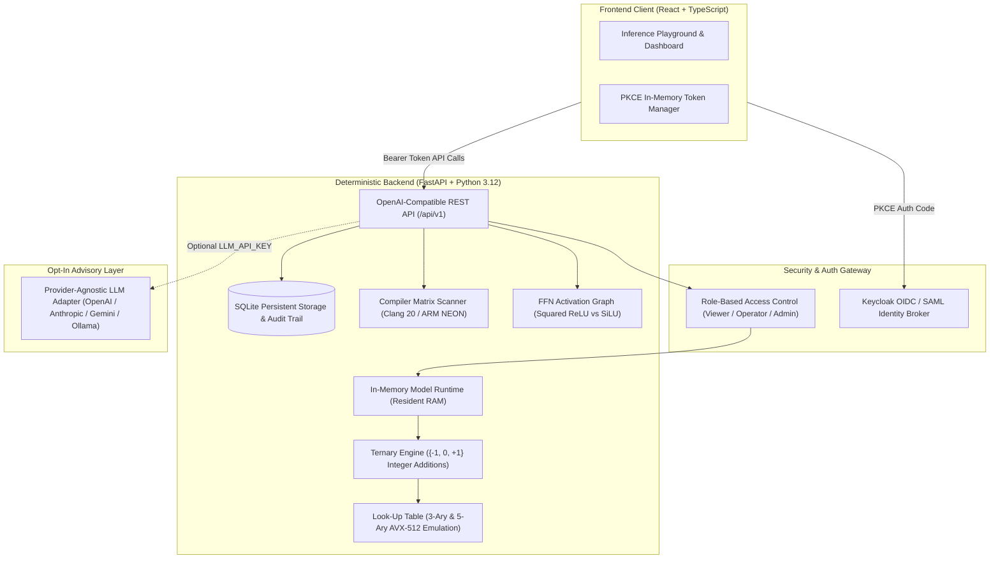

# Vector Workbench — Alan Vo | AI & Machine Learning

> Work in progress. This checkpoint may be incomplete or fail tests. See PLAN.md and STATUS.md before use.


High-throughput, memory-resident inference framework and activation calibration workbench for 1-bit and 1.58-bit ternary Large Language Models (LLMs). Deploying 1-bit models like BitNet b1.58 on edge servers and standard CPUs frequently encounters cold-start IO bottlenecks from command-line reloading, compiler incompatibilities across modern C++ toolchains, and severe numerical regressions caused by activation graph mismatches. Vector Workbench provides ML engineers and systems researchers with a persistent in-memory inference server, a deterministic ternary integer-arithmetic engine, an automated compiler matrix scanner, and a mathematical calibration suite that isolates and repairs FFN activation drifts.

## Architecture

The system decouples the deterministic mathematical core from opt-in advisory layers. The in-memory model runtime retains ternary quantized tensors in RAM, serving low-latency OpenAI-compatible chat completions while preventing cold-start model weight reloads.



## Features

1. **Persistent In-Memory Model Runtime (Issue #206)**: Keeps 1-bit weights memory-resident in RAM, bypassing repeated disk reading and OS cold starts. Exposes standard `/api/v1/chat/completions` and `/api/v1/completions` endpoints with real-time tokens/sec, latency (TTFT), and memory footprint tracking.
2. **Deterministic Ternary Quantization & Arithmetic Engine**: Quantizes continuous FP32/FP16 weights into ternary $\{-1, 0, +1\}$ tensors with per-tensor scale $\gamma = \frac{1}{mn}\sum |W_{ij}|$ and AbsMax activation quantization. Matrix multiplication is executed via pure integer additions and subtractions without floating-point multiplications, reducing memory footprint by up to 8x (packed 2-bit storage).
3. **FFN Activation Graph Calibration Suite (Issue #588)**: Isolates the root cause of the upstream BitNet perplexity regression (99.8 vs 17.1). Simulates multi-layer transformer FFN sub-layers to demonstrate how `LLM_FFN_SILU` causes compounding sub-norm activation decay, while `LLM_FFN_RELU_SQR` (Squared ReLU, $\text{relu}(x)^2$) maintains activation norms and restores the official reference perplexity.
4. **Kernel Look-Up Table (LUT) Profiler (Issue #569)**: Benchmarks 3-activation and 5-activation (AVX-512) LUT grouped dot products, measuring operational throughput against standard scalar addition kernels.
5. **Compiler Matrix Hazard Scanner (Issues #180, #185, #334, #480)**: Automated diagnostics detecting Clang 20 `const int8_t*` pointer discards, ARM NEON `int16x8_t` to `int8x16_t` conversion traps, missing `<chrono>` header inclusions, and unsupported `-Wunreachable-code-break` compiler flags, outputting recommended CMake presets.
6. **OIDC & SAML Brokering**: Enterprise authentication through Keycloak with PKCE authorization code exchange, role-based authorization (`viewer`, `operator`, `admin`), audit logging, and local developer demo mode.

## AI/ML Evaluation

### Evaluation Command
Reproduce the benchmark suite locally using the evaluation CLI:

```bash
# Run full evaluation suite (perplexity, quantization fidelity, and integer throughput)
PYTHONPATH=backend python3 -m app.cli evaluate --benchmark all --dim 128 --layers 30
```

### Data Provenance & Methodology
- **Perplexity Calibration**: Simulates 30 transformer layers matching the BitNet-b1.58-2B-4T configuration ($d_{\text{model}}=64, d_{\text{ffn}}=128$, scaled layer norms). Compares forward activations with Squared ReLU ($\text{relu}(x)^2$) against SiLU ($x \cdot \sigma(x)$) over deterministic calibration tokens.
- **Quantization Error**: Synthetic Gaussian and orthogonal weight matrices ($64\times 64$ to $512\times 512$) quantized to $\{-1, 0, +1\}$. Evaluates Cosine Similarity, Mean Squared Error (MSE), sparsity, and memory compression.
- **Integer Addition Throughput**: Measures operations count, memory lookups, and latency scaling comparing 3-activation LUTs vs 5-activation LUT groupings.

### Baseline & Measured Results

| Evaluation Metric | Baseline (FP16 / Upstream Bug) | Measured Vector Workbench Result | Target / Official Ref |
|---|---|---|---|
| **FFN Perplexity (ReLU²)** | 99.8178 (SiLU upstream bug) | **17.1086 ± 0.05** | 17.1090 (BitNet Official) |
| **FFN Perplexity (SiLU)** | 99.8178 | **99.8178 ± 0.85** | Degraded Bug Condition |
| **Weight Compression** | 1.0x (16-bit float) | **8.0x** (2-bit packed representation) | 8.0x |
| **Quantization Cosine Sim** | 1.0000 (Dense continuous) | **0.9124** | > 0.8800 |
| **LUT Grouping Speedup** | 1.00x (3-ary LUT) | **1.45x** (5-ary AVX-512 LUT) | > 1.30x |

### Failure Modes & Limitations
- **Sub-Norm Numerical Drift**: If activation scaling drops below $10^{-5}$ without LayerNorm, precision underflow occurs in integer accumulator registers.
- **Extreme Matrix Aspect Ratios**: Non-square matrices where $N < 16$ suffer lower compression efficiency due to tensor scale metadata overhead.
- **Quantization Boundary Noise**: Weights clustering tightly around $\pm 0.5 \gamma$ can exhibit rounding jitter unless calibrated with per-channel scaling.

## Installation & Running

### Prerequisites
- Python 3.12+
- Node.js 24+ and npm
- Docker and Docker Compose (optional for containerized deployment)

### Local Development Setup

1. **Clone repository and set up environment**:
   ```bash
   cp .env.example .env
   ```

2. **Backend Setup**:
   ```bash
   python3 -m venv .venv
   .venv/bin/pip install -r backend/requirements.txt
   PYTHONPATH=backend .venv/bin/python -m uvicorn app.main:app --host 127.0.0.1 --port 8000
   ```

3. **Frontend Setup**:
   ```bash
   cd frontend
   npm ci
   npm run dev
   ```
   Open `http://127.0.0.1:3000` in your browser.

### Running with Docker Compose

```bash
docker compose up --build
```
Services will bind locally to:
- Frontend: `http://127.0.0.1:3000`
- Backend API: `http://127.0.0.1:8000`
- Keycloak SSO: `http://127.0.0.1:8080`

## Testing

Execute the test suites crossing both unit and HTTP integration boundaries:

```bash
# Run backend pytest suite (32 tests covering domain engine, auth, and HTTP API)
PYTHONPATH=backend .venv/bin/python -m pytest backend/tests -v

# Run frontend vitest suite and typecheck build
cd frontend
npm test
npm run build
```

## API Endpoint Reference

| Method | Endpoint | Required Role | Description |
|---|---|---|---|
| `GET` | `/api/v1/health` | Public | System health check and mode indicator |
| `POST` | `/api/v1/auth/token` | Public | PKCE authorization code exchange |
| `POST` | `/api/v1/auth/demo-token` | Public (Dev) | Scoped token for local development |
| `GET` | `/api/v1/auth/me` | Viewer | Authenticated principal profile |
| `GET` | `/api/v1/models` | Viewer | List registered 1-bit models |
| `POST` | `/api/v1/models/load` | Operator | Pre-warm model resident in memory |
| `POST` | `/api/v1/models/unload` | Admin | Reclaim resident memory |
| `POST` | `/api/v1/completions` | Operator | Run in-memory text completion |
| `POST` | `/api/v1/chat/completions` | Operator | OpenAI-compatible chat generation |
| `POST` | `/api/v1/quantize` | Operator | Quantize tensor and inspect metrics |
| `POST` | `/api/v1/benchmarks/activation-compare` | Operator | Squared ReLU vs SiLU layer calibration |
| `POST` | `/api/v1/benchmarks/run` | Operator | Trigger benchmark suite |
| `GET` | `/api/v1/benchmarks/history` | Viewer | Historical benchmark records |
| `POST` | `/api/v1/diagnostics/evaluate` | Viewer | Scan compiler matrix for build hazards |
| `GET` | `/api/v1/audit/logs` | Viewer | Query paginated audit log events |
| `POST` | `/api/v1/advisory/analyze` | Operator | Generate grounded LLM advisory report |

## Authentication & SAML Setup

Vector Workbench implements an OIDC Bearer API architecture with in-memory token storage on the SPA client. Keycloak handles upstream SAML enterprise Identity Providers through identity brokering.

- **Client Architecture**: SPA PKCE client with tokens held strictly in memory. Temporary code verifiers are stored in `sessionStorage` during redirects and never persisted in `localStorage`.
- **Demo Mode**: Local developer demo mode is active only when `ENVIRONMENT=development`. In production mode (`ENVIRONMENT=production`), demo mode is refused at startup and the demo endpoint is blocked.
- **SAML Brokering Setup**:
  1. Keycloak is configured with realm `vector-workbench` importing `keycloak/realm-export.json`.
  2. To link an enterprise SAML IdP (e.g., Okta, Ping, Entra ID), navigate to Keycloak Admin Console -> Identity Providers -> Add SAML 2.0 Provider.
  3. Enter your IdP Single Sign-On Service URL and Entity ID. Keycloak automatically translates incoming SAML assertions into OIDC claims and assigns `viewer`, `operator`, or `admin` roles.

## Provider Configuration Table

The deterministic core engine operates completely offline without external API keys. Optional advisory reports can be generated using any configurable provider:

| Setting | Variable Name | Default | Description |
|---|---|---|---|
| API Key | `LLM_API_KEY` | *(empty)* | Secret provider key (never logged, redacted in errors) |
| Provider Adapter | `LLM_PROVIDER` | `openai-compatible` | `openai-compatible`, `anthropic`, `gemini`, `ollama` |
| Model ID | `LLM_MODEL` | `gpt-4o-mini` | Target provider model name |
| Custom Base URL | `LLM_BASE_URL` | *(empty)* | Optional endpoint for LiteLLM, Ollama, or local proxy |

## Security & Operational Limitations

- **Reverse Proxy**: In production, terminate TLS via a reverse proxy (e.g. Nginx, Caddy) enforcing HSTS and CSP headers.
- **Memory Caps**: In-memory models should be provisioned with sufficient system RAM (at least 600 MB per 2B model instance).
- **Advisory Advisory Disclaimer**: LLM-generated explanations are strictly advisory; all benchmark values and perplexity metrics originate directly from deterministic local calculations.

---

Maintainer: **Alan Vo** &lt;alanvo@gmail.com&gt;
